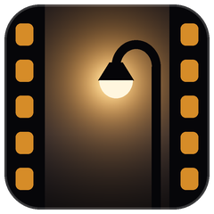
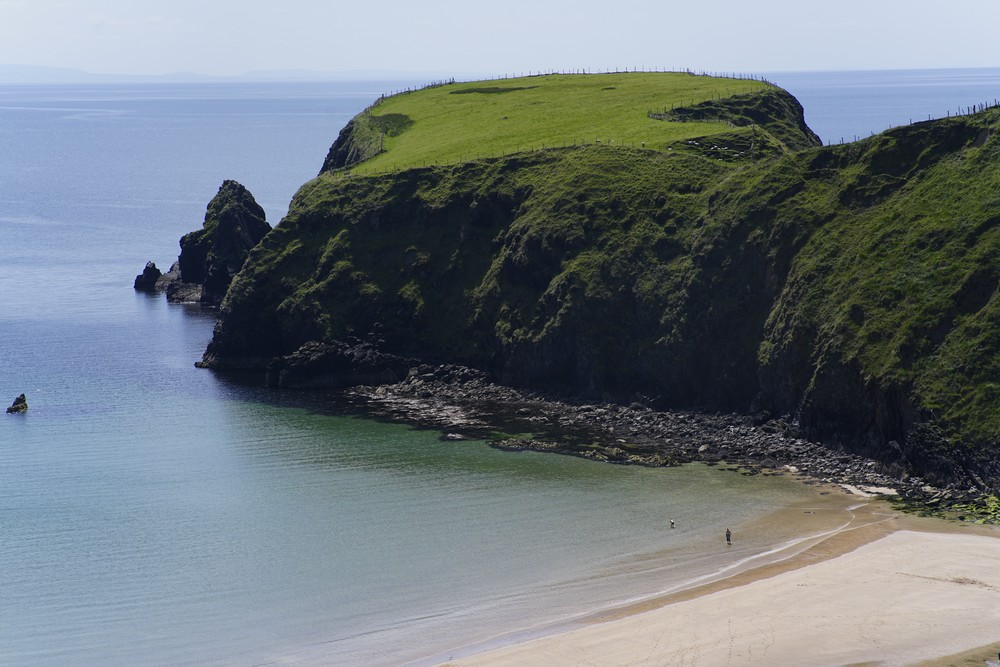
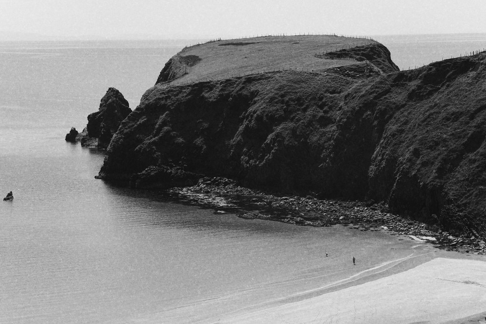
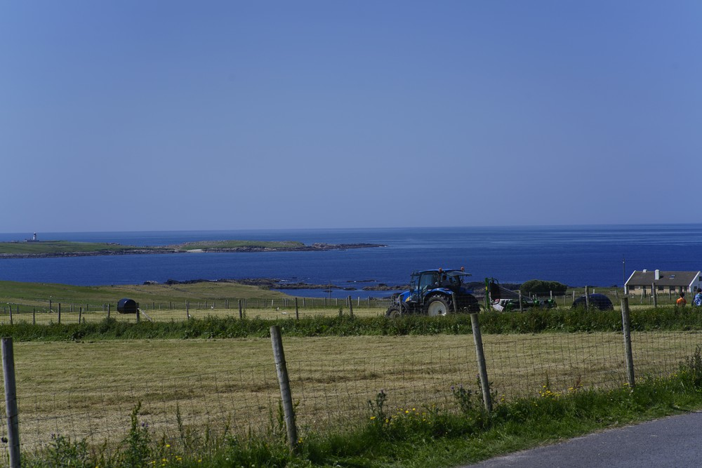
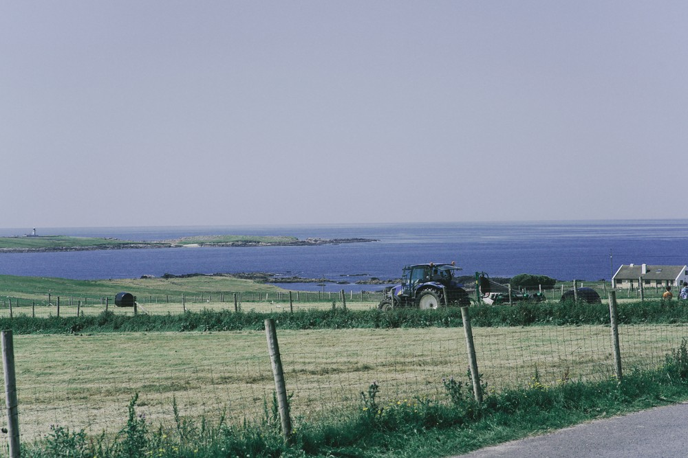
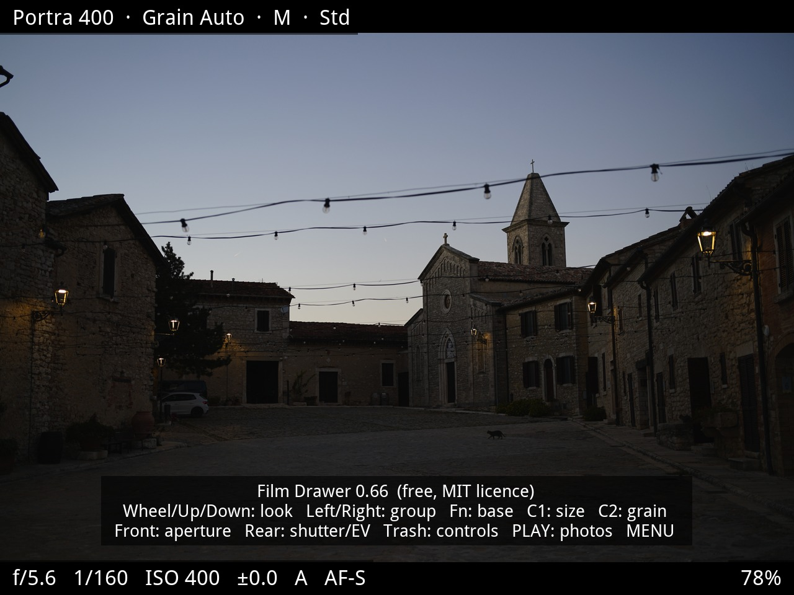
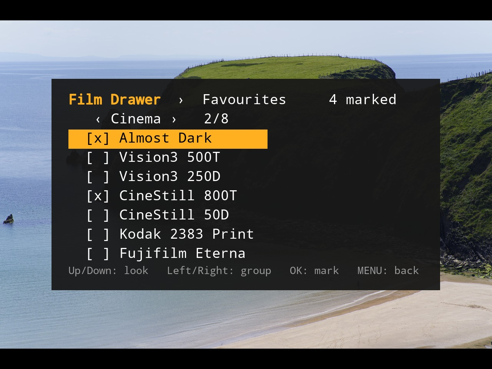
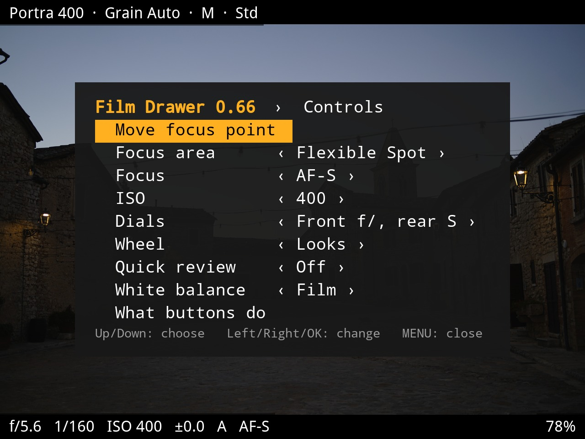
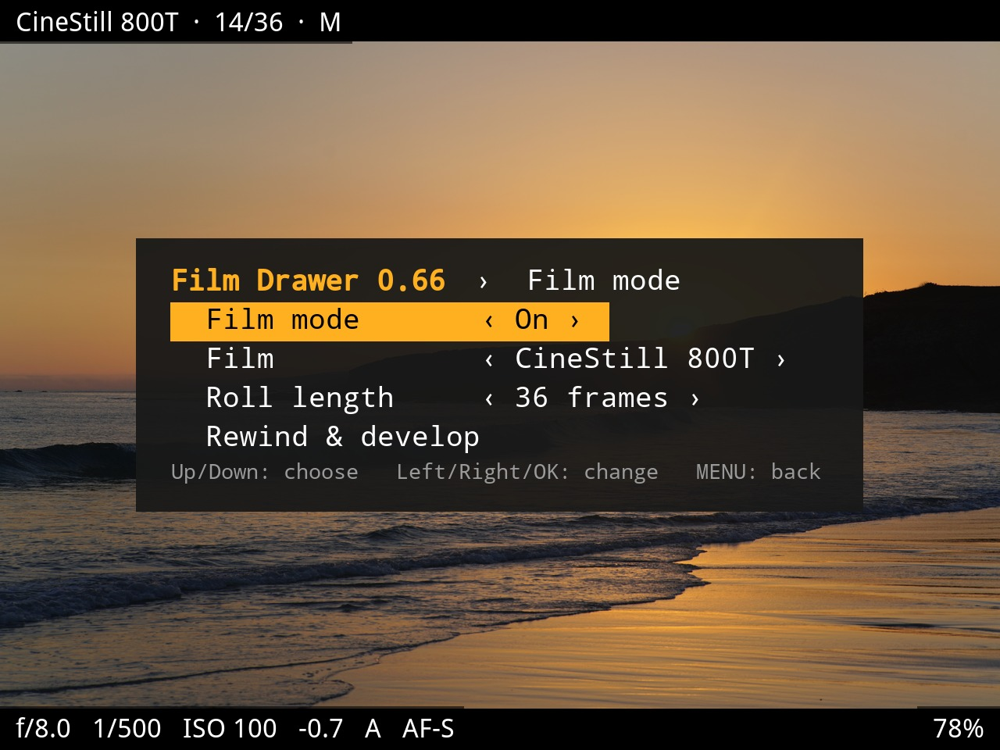

# Film Drawer

Film looks for Sony cameras that run PlayMemories Camera Apps. Shoot as normal; each JPEG is
converted in the background with the film look you picked. Your originals are never changed.

By Almost Dark Studio: https://almostdarkstudio.com

**Free and open source (MIT).** If you enjoy it, a donation is welcome:

> **Tested cameras:** the **Sony a7R II** (developed on it) and the original **a7** (one user, up to 0.52; slower there).
> Every other body that runs PlayMemories apps (a7R, a7S, a7 II, a7S II, a5100, a6000, a6300, a6500, NEX-5T, NEX-6,
> RX100 III-V, RX10 III and others) is **untested**: it may work, partly work, or not at all. If you try one, please
> [tell us](../../issues/new/choose). Use at your own risk.

**Read about it:** [The Phoblographer tried Film Drawer on an original a7](https://www.thephoblographer.com/2026/11/25/sony-a7-cinestill-800t-hack-film-drawer/)
(25 November 2026, versions up to 0.52). Since then the grain works differently (0.55, and again in 0.59), the
halation was rebuilt (0.60) and several looks have changed: see the [releases](../../releases).

## What it does
- 41 looks in 8 groups: Kodak negative, Cinema, Fuji & Agfa negative, Fuji simulations, Slide,
  Instant, Specialty (Metropolis, Aerochrome-style infrared), Black & white. Film grain per look,
  sized to the photo and with its own grain in each colour layer;
  CineStill 800T is tuned against real scans, with the red-orange halation around lights; 50D has a gentler one.
  **Almost Dark**, in Cinema, is the studio's own low-light look: deep blacks, rich lamplight, clean lights.
- Shoot inside the app. The conversion runs in
  the background (about 20-40 s per photo at JPEG size M on an a7R II, CineStill 800T the longest). When it is done,
  "Developed" and the film's name show for a moment. A quick review of each photo in its look is in Controls (off by default).
- **The film's own white balance** (Sony a7R II): each look of a film with a fixed balance shows it as a lab scan of that
  film looked, so a daylight film goes amber under lamps and CineStill 800T cool in daylight and blue at dusk. Worked
  out for each photo from the white balance your camera chose (Controls > White balance: Film, Film (full) or Camera).
- **Film mode** (MENU > Film mode): load a roll of one film, 24 or 36 frames, and shoot it like film. The film, grain,
  base style and size are fixed for the roll, there is no review, and PLAY is off. When the roll is finished (or you
  rewind it), it is developed and the whole roll comes back at once. You choose the film before you shoot, not after,
  and with nothing to check on the back you stay with what is in front of you.
- Mark your **favourites** (MENU > Favourites) and they become the first group.
- Browse any photo on the card, preview a look, and convert it. Or view your converted photos
  (the camera's own playback cannot show them) and delete the ones you don't want: PLAY.
- Converted files go to a folder of the day the photo was taken, `FILMDRAW\<date>\<TAG><number>.JPG` (for example
  `FILMDRAW\20261126\P4002097.JPG` = DSC02097 in Portra 400), and in Film mode to one folder per roll
  (`FILMDRAW\ROLL0001\`). EXIF is kept. Up to 0.57 the folder was the camera's (`FILMDRAW\100MSDCF\`): those stay
  where they are.
  (Up to 0.34 the folder was `FILMLUT`. The app still shows what is in it, and never moves it.)

## Examples
| Camera JPEG | CineStill 800T |
|---|---|
|  |  |

| Camera JPEG | Tri-X 400 |
|---|---|
|  |  |

| Camera JPEG | Fuji 400H |
|---|---|
|  |  |

*Sony a7R II, with the app's own engine and default settings for each look: colour or black and white tones, grain,
and for CineStill the red halation around the lights and the film's white balance. CineStill 800T made with 0.65, Tri-X
with 0.60, Fuji 400H with 0.61; resized for this page, no other editing. Photos: Almost Dark Studio.*

## Screenshots
| | |
|---|---|
|  Shooting (help shows for a few seconds) |  Changing look: the card shows your last shot in it |
|  MENU |  All photos: one converted with Almost Dark |
|  Quick review: the shot you just took, in Almost Dark |  PLAY: your converted photos (Aerochrome) |
|  MENU > Favourites: mark the looks you use |  Controls: press Trash while shooting |
|  MENU > Film mode: a roll of CineStill 800T, 14 of 36 frames | |

*Drawn for 0.66 from the app's layout with its own film engine; the camera has no screenshot function, and its fonts may differ a little.*

## Download
Get `FilmDrawer-<version>.apk` and `SHA256SUMS.txt` from the [Releases](../../releases) page.

## Installing
Film Drawer is installed the same way as any other PlayMemories app on these cameras, with
**Sony-PMCA-RE** (https://github.com/ma1co/Sony-PMCA-RE):

1. On the camera, set **USB Connection** to **MTP** (Setup menu).
2. Connect the camera to your computer and start Sony-PMCA-RE (`pmca-gui`, or
   `pmca-console install -f FilmDrawer-<version>.apk`).
3. In the GUI, open **Install app**, choose **Select an apk**, pick `FilmDrawer-<version>.apk`, and press
   **Install**. Keep the cable connected until it says the task completed.
4. On the camera: **Menu > Application > Application List > Film Drawer**.

Check the download first: `SHA256SUMS.txt` lists the APK's checksum.

**macOS and Linux:** Sony-PMCA-RE runs there too, see its
[instructions](https://github.com/ma1co/Sony-PMCA-RE#installation). The Phoblographer installed Film Drawer from a Mac;
we have only used Windows. On a Mac, close anything that may grab the camera first (Photos, Dropbox, Google Drive).

**While it installs**
- Start with a full battery, and use a cable that carries data.
- Do not touch the camera or the cable until it says the task completed.
- If something fails, stop and read the message rather than trying again and again.

**If an AI assistant helps you:** only the app installer is needed (`install`). Film Drawer never needs the firmware
updater, service mode, `updatershell`, `serviceshell` or Zadig drivers, and those can change more than an app does.

**What to expect:** there is no live film preview. You shoot as usual, and the camera renders the photo in the background:
about 20-40 s at JPEG size M on an a7R II, a minute or more at 24 MP on an original a7. Rendering uses battery, so carry a
spare. A smaller JPEG size (C1) is quicker.

## Controls
| | Shoot mode | Browse mode |
|---|---|---|
| Wheel / Up / Down | Change look (a card shows your last photo in that look). The wheel can change ISO instead (Controls > Wheel) | Change look (converted photos: change photo) |
| Left / Right | Jump to the previous / next look group | Previous / next photo |
| Front dial | Aperture (A/M/P), or shutter speed (Controls > Dials) | Change look (converted photos: change photo) |
| Rear dial | Shutter speed (S/M), else exposure compensation, or aperture (Controls > Dials) | Previous / next photo |
| Fn | Base style: Standard / Neutral / Camera settings | Switch between all photos and converted photos |
| C1 | JPEG size in the app: M / S / L, with your camera's megapixels | |
| EV dial (a7R II) | Exposure compensation follows the dial | |
| C2 | Grain: Auto (per look) / Off / Low / Medium / High | Same |
| OK | Show / hide help | Convert this photo (converted photos: show / hide help) |
| Trash | **Controls**: the list below, with Move focus point first | All photos: before / after. Converted photos: delete (asks first; only the converted copy, never the original) |
| PLAY | Your converted photos, newest first (Fn: all photos). Not in Film mode | Back to shooting (or half-press) |
| MENU | Menu: look, grain, base style, JPEG size, quick review, **Film mode**, **Controls**, **Favourites**, photos, about, **Exit application** | Same |

**Controls** (Trash while shooting, or MENU > Controls):
- **Move focus point**: the arrows move it, OK or half-press keeps it, Trash goes back to the earlier focus area.
- **Focus area**: Wide, Center or Flexible Spot. The box turns green when focus locks.
- **Focus**: AF-S / AF-A / AF-C / DMF / MF, those your camera has (the AF/MF-AEL button does not work in the app). Your
  own choice is put back when you leave. Lock-on AF and Eye AF are not available.
- **ISO**, **Dials** (which one is shutter speed) and **Wheel** (looks or ISO; with ISO, looks stay on Up / Down).
- **What buttons do**.

**Favourites** (MENU > Favourites): Left / Right for the group, Up / Down for the look, OK to mark or unmark it. Once
you have marked one, Favourites is the first group, so Left / Right reaches it while shooting; after your last favourite
the wheel carries on into Kodak. Each look also stays in its own group.

**Film mode** (MENU > Film mode): Film mode On, the Film, and Roll length (24 or 36). The roll starts with your next
shot, in the film chosen then; from that shot on the film, grain, base style and JPEG size stay as they were, and the top
bar shows the frame count (`CineStill 800T · 14/36 · M`). There is no quick review, PLAY and All photos are off, and the
photos convert out of sight. At the last frame the roll goes to the lab and this menu opens, to choose the next film or
turn Film mode off. Once all its frames are converted the roll is developed ("Developed CineStill 800T · 36 frames") and
is in PLAY, in its own folder. **Rewind & develop** (OK twice) finishes a roll early. Turning Film mode off with frames on
the roll asks whether to develop them now (OK) or keep the roll for later (Left / Right). A burst uses one frame per
photo, as a motor drive does. The camera's own playback still shows its original JPEGs.

**Deleting a converted photo** (PLAY, then Trash): the app asks first, with Cancel chosen. Up, then OK, deletes it. Trash
again, MENU, PLAY or a half-press cancels. Only the converted copy is deleted, and the app warns you if the original is
no longer on the card. The app never deletes originals: use the camera's own playback for those.

The camera's mode dial sets the exposure mode as usual (P/A/S/M). Everything on Fn, C1 and C2 is also in the menu, for
bodies without those buttons. To leave the app: MENU > Exit application (photos still
converting carry on next time).

## The looks
In menu order (your favourites, if you mark any, come first). The app opens on Portra 400 the first time, then on the look you used last.

| Group | Looks |
|---|---|
| Kodak negative | Portra 400, Portra 160, Portra 800, Gold 200, UltraMax 400, ColorPlus 200, Ektar 100 |
| Cinema | Almost Dark, Vision3 500T, Vision3 250D, CineStill 800T, CineStill 50D, Kodak 2383 Print, Fujifilm Eterna |
| Fuji & Agfa negative | Fuji 400H, Fuji Pro 160NS, Reala 100, Superia 400, Superia 1600, Fujicolor C200, Agfa Vista 200 |
| Fuji simulations | Classic Chrome, Classic Negative |
| Slide | Kodachrome 64, Ektachrome E100, Ektachrome 100VS, Provia 100F, Astia 100F, Velvia 50 |
| Instant | Polaroid 669, Polaroid SX-70, Fuji FP-100C |
| Specialty | Lomo Metropolis, Aerochrome |
| Black & white | Tri-X 400, Ilford HP5, T-Max 400, Delta 3200, Acros 100, Pan F Plus 50, Infrared |

## Your camera settings
While you shoot in Film Drawer, the app sets a neutral base so the looks come out consistently:
Creative Style Standard (or Neutral) with contrast and saturation 0, DRO off, and your chosen JPEG
size, focus mode, focus area and (for CineStill) sharpness. The looks are applied to the JPEG, so if your camera is set
to RAW only, the app shoots RAW+JPEG while it is open. It saves your own settings first and is designed to put
them back when you leave the app with MENU > Exit application, or the next time you open it if the
camera was switched off. Please check your settings the first time. Choose
"Camera settings" (Fn) to leave your Creative Style alone. RAW files are never affected.

## Known limits
- **"Live view failed" (a7):** after viewing photos, the live view sometimes did not come back on an original a7. 0.48
  changed how it starts, but that is not confirmed there yet. If it happens: half-press to try again, or MENU > Exit
  application and open the app again. Please report it with `FILMDRAW\HANG.TXT`.
- Lock-on (tracking) AF, Eye AF, the Zone and expanded focus areas, and the camera's own custom buttons and dial settings
  do not work in the app.
- RAW files already on the card without a JPEG cannot be converted.
- The film balance (Controls > White balance: Film) reads the white balance the camera records in each photo, known for the
  a7R II only: on other cameras the looks use the photo as the camera balanced it (so CineStill 800T goes less blue in
  daylight than real film). It works from what Auto chose; with a manual white balance it works from that setting.
- Previews (on the camera and in the photo file) do not show the grain; the photo itself does.
- If your camera keeps contrast, saturation and sharpness separately for each Creative Style, your own values for Standard
  and Neutral may be left at the app's (not confirmed). If you have changed those two styles, please check them.
- On an original a7, a 24 MP photo takes a minute or more to convert.

## Problems
- If the app freezes or crashes it writes `FILMDRAW\HANG.TXT` or `FILMDRAW\CRASH.TXT` on the card.
  Please include that file, your camera model and the app version (shown in the help) in a bug report.
- For detailed logs, create an empty file `FILMDRAW\DEBUG.TXT` on the card. The app then also writes
  `LOG.TXT` (conversion timings), `FOCUS.TXT`, `KEYS.TXT`, `TRACE.TXT` and `PARAMS.TXT`. Delete it to turn them off again.

## Requests and feedback
Missing a film stock, or using a camera that has not been tested? [Open an issue](../../issues/new/choose):
- **Look request:** a stock or look you would like, or one that looks wrong to you. Your own scans help most. Looks must be free to share, so please
  do not send paid presets or LUTs.
- **Camera report:** what works, or does not, on your model.
- **Bug report:** what happened, with `CRASH.TXT` or `HANG.TXT` if there is one.

Issues are public, so please remove location data from any photos first. This is a spare-time project: every request
is welcome, but not all of them can be promised.

## Removing
Camera: **Menu > Application > Application List > Application Management > Manage and Remove**.
Leave Film Drawer normally (MENU > Exit application) first, so your camera settings are back. Converted photos in
`FILMDRAW\` stay on the card.

## Acknowledgements
- Chris Gampat, The Phoblographer, "Exclusive: I Hacked a Sony a7 With AI to Do What Sony Took Away" (16 October 2026):
  https://www.thephoblographer.com/2026/10/16/exclusive-i-hacked-a-sony-a7-with-ai-to-do-what-sony-took-away/
  - the article that started this project.
- Sony-PMCA-RE by ma1co (https://github.com/ma1co/Sony-PMCA-RE), which makes installing apps possible, and
  OpenMemories-Framework for documenting the camera's Sony APIs.
- The Archive.org PlayMemories Camera Apps collection (https://archive.org/download/sony-playmemories-camera-apps).
- libjpeg-turbo; the RawTherapee Film Simulation Collection (Pat David, Pavlov Dmitry, Michael Ezra); EmulsionPresets.

## Licences
Film Drawer: MIT (`LICENSE`). Bundled libjpeg-turbo and the film looks have their own licences
(`NOTICE`, `LOOKS-LICENSE.txt`). This software is based in part on the work of the Independent JPEG
Group. Film and product names are trademarks of their owners, used only to describe the look each
LUT approximates; Film Drawer is not affiliated with or endorsed by them, or by Sony.

## Building from source
See [DEVELOPMENT.md](DEVELOPMENT.md). Developer notes refer to a local install wrapper (`src\pmca.ps1`) that is not part of this repository; any Sony-PMCA-RE install works.
