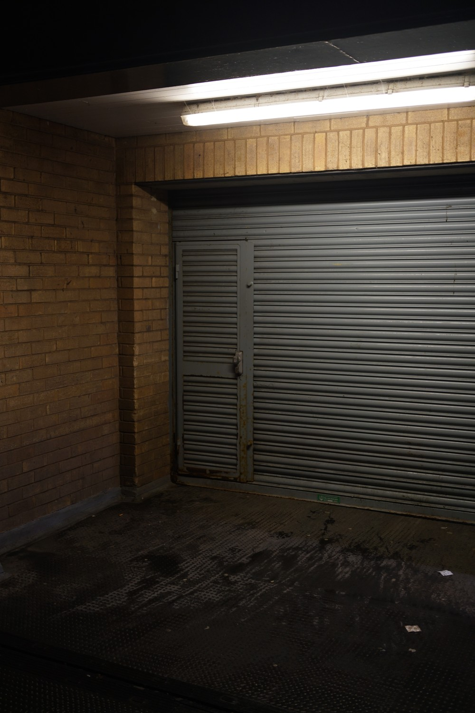
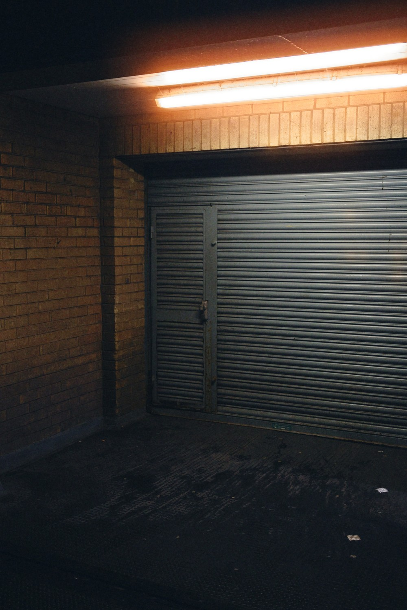
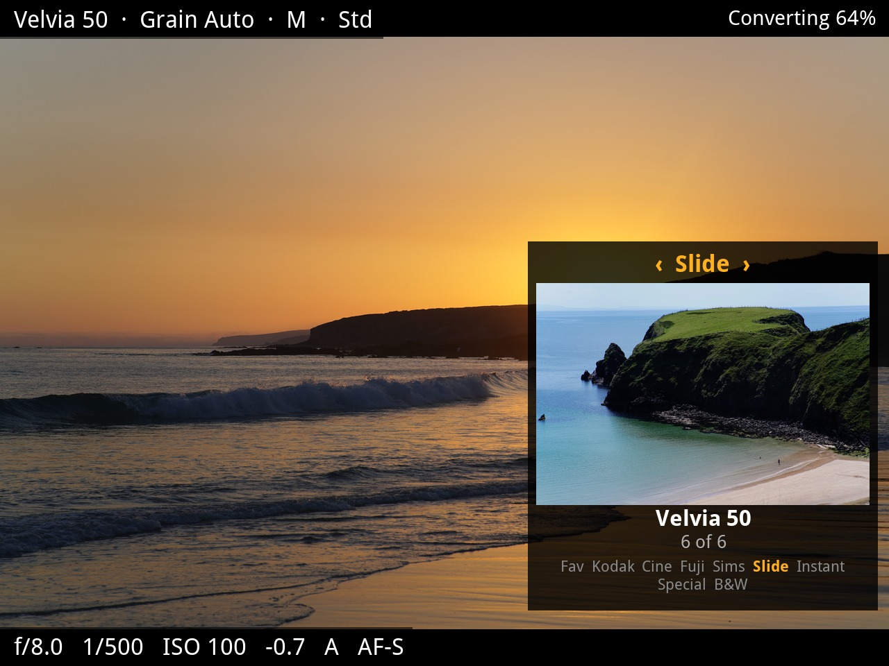
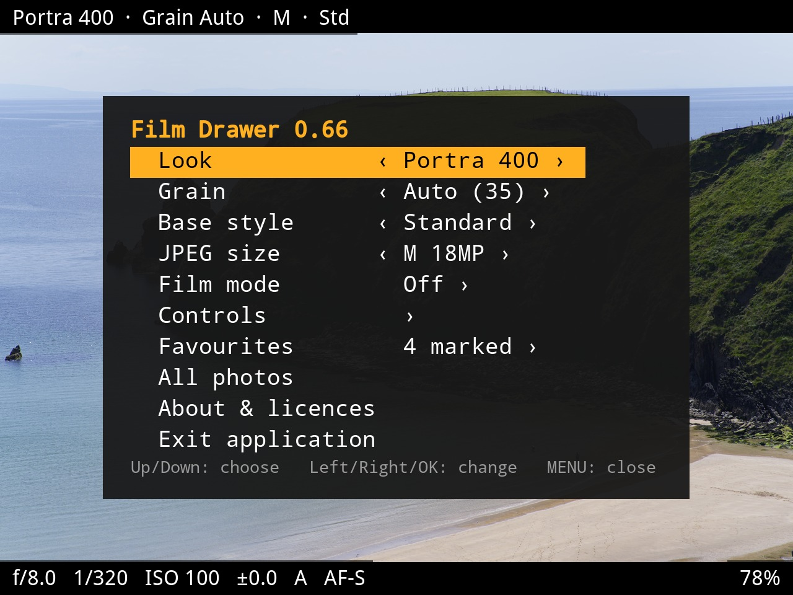
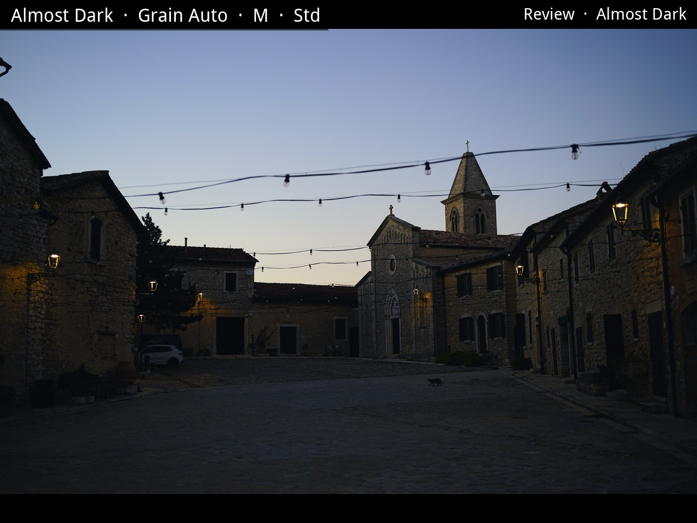

# Film Drawer

Film looks for Sony cameras that run PlayMemories Camera Apps. Shoot as normal; each JPEG is
converted in the background with the film look you picked. Your originals are never changed.

By Almost Dark Studio: https://almostdarkstudio.com

**Free and open source (MIT).** If you enjoy it, a donation is welcome:

> Developed and tested on the **Sony a7R II**. One user has run it on the original **a7** (slower there). Other
> bodies that run PlayMemories apps (a6000, a6300, a6500, a7 II, a7S II, RX100 III-V and others) may work but have
> not been tested. Use at your own risk.

## What it does
- 40 looks in 8 groups: Kodak negative, Cinema, Fuji & Agfa negative, Fuji simulations, Slide,
  Instant, Specialty (Metropolis, Aerochrome-style infrared), Black & white. Film grain per look;
  CineStill looks add a red halation glow around lights.
  **Almost Dark**, in Cinema, is the studio's own low-light look: deep blacks, rich lamplight, clean lights.
- Shoot inside the app. A quick review shows each photo in its look, and the conversion runs in
  the background (about 20-25 s per photo at JPEG size M on an a7R II).
- Browse any photo on the card, preview a look, and convert it. Or view your converted photos
  (the camera's own playback cannot show them): Fn in browse mode, or MENU > Converted photos.
- Converted files go to `FILMDRAW\<folder>\<TAG><number>.JPG` (for example
  `FILMDRAW\100MSDCF\P4002097.JPG` = DSC02097 in Portra 400). EXIF is kept.
  (Up to 0.34 the folder was `FILMLUT`. The app still shows what is in it, and never moves it.)

## Example
| Camera JPEG | CineStill 800T |
|---|---|
|  |  |

*Sony a7R II, with the app's own engine and settings for the look: colour, grain and the red halation around the
lights. Resized for this page, no other editing. Photo: Almost Dark Studio.*

## Screenshots
| | |
|---|---|
|  Shooting (help shows for a few seconds) |  Changing look: the card shows your last shot in it |
|  MENU |  Browsing a photo converted with Almost Dark |
|  Quick review: the shot you just took, in Almost Dark |  Your converted photos (Aerochrome) |

*Recreated from the app's layout code with its own film engine; the camera has no screenshot function.*

## Download
Get `FilmDrawer-<version>.apk` and `SHA256SUMS.txt` from the [Releases](../../releases) page.

## Installing
Film Drawer is installed the same way as any other PlayMemories app on these cameras, with
**Sony-PMCA-RE** (https://github.com/ma1co/Sony-PMCA-RE):

1. On the camera, set **USB Connection** to **MTP** (Setup menu).
2. Connect the camera to your computer and start Sony-PMCA-RE (`pmca-gui`, or
   `pmca-console install -f FilmDrawer-<version>.apk`).
3. In the GUI, open **Install app**, choose **Select an apk**, pick `FilmDrawer-<version>.apk`, and press
   **Install**. Keep the cable connected until it says the task completed.
4. On the camera: **Menu > Application > Application List > Film Drawer**.

Check the download first: `SHA256SUMS.txt` lists the APK's checksum.

## Controls
| | Shoot mode | Browse mode |
|---|---|---|
| Wheel / Up / Down | Change look (a card shows your last photo in that look). The wheel can change ISO instead, see below | Change look |
| Left / Right | Jump to the previous / next look group | Previous / next photo |
| Front dial | As set on your camera if it says so, else aperture (A/M/P) | Change look |
| Rear dial | As set on your camera if it says so, else shutter speed (S/M) or exposure compensation | Previous / next photo |
| Focus area (Wide / Center / Flexible Spot) | MENU > Focus area. The box turns green when focus locks | |
| ISO, dials, wheel | MENU > ISO. MENU > Dials: as camera, or choose which dial is shutter. MENU > Wheel: as camera, ISO or looks (with ISO, looks stay on Up / Down) | |
| Fn | Base style: Standard / Neutral / Camera settings | Switch between all photos and converted photos |
| C1 | JPEG size in the app: M / S / L, with your camera's megapixels | |
| EV dial (a7R II) | Exposure compensation follows the dial | |
| Focus mode (AF / MF / DMF) | MENU > Focus (the AF/MF-AEL button does not work in the app) | |
| C2 | Grain: Auto (per look) / Off / Low / Medium / High | Same |
| OK | Show / hide help | Convert this photo |
| Trash | Move the focus point: arrows move it, OK or half-press keeps it, Trash again goes back | Before / after (all photos) |
| PLAY | Browse | Back to shooting (or half-press) |
| MENU | Menu: look, grain, base style, JPEG size, focus, focus area, move focus point, ISO, dials, wheel, quick review, converted photos, help, about, **Exit application** | Same |

The camera's mode dial sets the exposure mode as usual (P/A/S/M). In 0.32 and earlier, set it before opening the app:
turning it in the app had no effect. Everything on Fn, C1 and C2 is also
in the menu, for bodies without those buttons. To leave the app: MENU > Exit application (photos still
converting carry on next time).

## Your camera settings
While you shoot in Film Drawer, the app sets a neutral base so the looks come out consistently:
Creative Style Standard (or Neutral) with contrast and saturation 0, DRO off, and your chosen JPEG
size, focus mode, focus area and (for CineStill) sharpness. The looks are applied to the JPEG, so if your camera is set
to RAW only, the app shoots RAW+JPEG while it is open. It saves your own settings first and is designed to put
them back when you leave the app with MENU > Exit application, or the next time you open it if the
camera was switched off. Please check your settings the first time. Choose
"Camera settings" (Fn) to leave your Creative Style alone. RAW files are never affected.

## Problems
- If the app freezes or crashes it writes `FILMDRAW\HANG.TXT` or `FILMDRAW\CRASH.TXT` on the card.
  Please include that file, your camera model and the app version (shown in the help) in a bug report.
- For detailed logs, create an empty file `FILMDRAW\DEBUG.TXT` on the card. The app then also writes
  `LOG.TXT` (conversion timings), `FOCUS.TXT`, `KEYS.TXT`, `TRACE.TXT` and `PARAMS.TXT`. Delete it to turn them off again.

## Requests and feedback
Missing a film stock, or using a camera that has not been tested? [Open an issue](../../issues/new/choose):
- **Look request:** a stock or look you would like. Your own scans help most. Looks must be free to share, so please
  do not send paid presets or LUTs.
- **Camera report:** what works, or does not, on your model.
- **Bug report:** what happened, with `CRASH.TXT` or `HANG.TXT` if there is one.

Issues are public, so please remove location data from any photos first. This is a spare-time project: every request
is welcome, but not all of them can be promised.

## Removing
Camera: **Menu > Application > Application List > Application Management > Manage and Remove**.
Leave Film Drawer normally (MENU > Exit application) first, so your camera settings are back. Converted photos in
`FILMDRAW\` stay on the card.

## Acknowledgements
- Chris Gampat, The Phoblographer, "Exclusive: I Hacked a Sony a7 With AI to Do What Sony Took Away" (16 October 2026):
  https://www.thephoblographer.com/2026/10/16/exclusive-i-hacked-a-sony-a7-with-ai-to-do-what-sony-took-away/
  - the article that started this project.
- Sony-PMCA-RE by ma1co (https://github.com/ma1co/Sony-PMCA-RE), which makes installing apps possible, and
  OpenMemories-Framework for documenting the camera's Sony APIs.
- The Archive.org PlayMemories Camera Apps collection (https://archive.org/download/sony-playmemories-camera-apps).
- libjpeg-turbo; the RawTherapee Film Simulation Collection (Pat David, Pavlov Dmitry, Michael Ezra); EmulsionPresets.

## Licences
Film Drawer: MIT (`LICENSE`). Bundled libjpeg-turbo and the film looks have their own licences
(`NOTICE`, `LOOKS-LICENSE.txt`). This software is based in part on the work of the Independent JPEG
Group. Film and product names are trademarks of their owners, used only to describe the look each
LUT approximates; Film Drawer is not affiliated with or endorsed by them, or by Sony.

## Building from source
See [DEVELOPMENT.md](DEVELOPMENT.md). Developer notes refer to a local install wrapper (`src\pmca.ps1`) that is not part of this repository; any Sony-PMCA-RE install works.
