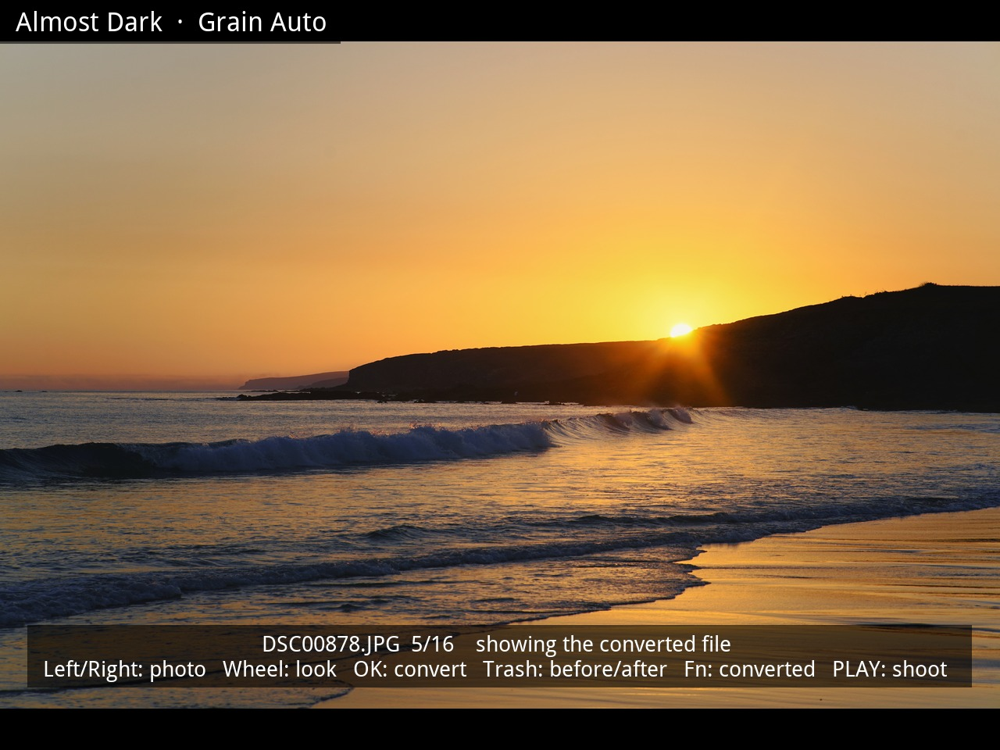
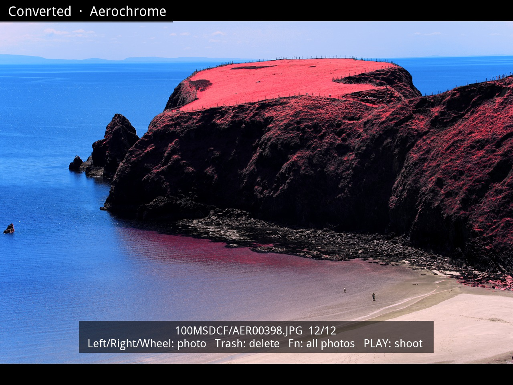

# Film LUT

Film looks for Sony cameras that run PlayMemories Camera Apps. Shoot as normal; each JPEG is
converted in the background with the film look you picked. Your originals are never changed.

By Almost Dark Studio: https://almostdarkstudio.com

**Free and open source (MIT).** If you enjoy it, a donation is welcome:

> Tested on the **Sony a7R II** only. Other bodies that run PlayMemories apps (a6000, a6300, a6500,
> a7 II, a7S II, RX100 III-V and others) may work but have not been tested. Use at your own risk.

## What it does
- 39 looks in 8 groups: Kodak negative, Cinema, Fuji & Agfa negative, Fuji simulations, Slide,
  Instant, Specialty (Metropolis, Aerochrome-style infrared), Black & white. Film grain per look;
  CineStill looks add a red halation glow around lights.
- Shoot inside the app. A quick review shows each photo in its look, and the conversion runs in
  the background (about 20-25 s per photo at JPEG size M on an a7R II).
- Browse any photo on the card, preview a look, and convert it. Or view your converted photos
  (the camera's own playback cannot show them): Fn in browse mode, or MENU > Converted photos.
- Converted files go to `FILMLUT\<folder>\<TAG><number>.JPG` (for example
  `FILMLUT\100MSDCF\P4002097.JPG` = DSC02097 in Portra 400). EXIF is kept.

## Screenshots
| | |
|---|---|
|  |  |
| Shooting (help shows for a few seconds) | Changing look: the card shows your last shot in it |
|  |  |
| MENU | Browsing a photo in CineStill 800T (note the halation) |
|  | |
| Your converted photos (Aerochrome) | |

*Recreated from the app's layout code with its own film engine; the camera has no screenshot function.*

## Download
Get `FilmLUT-<version>.apk` and `SHA256SUMS.txt` from the [Releases](../../releases) page.

## Installing
Film LUT is installed the same way as any other PlayMemories app on these cameras, with
**Sony-PMCA-RE** (https://github.com/ma1co/Sony-PMCA-RE):

1. On the camera, set **USB Connection** to **MTP** (Setup menu).
2. Connect the camera to your computer and start Sony-PMCA-RE (`pmca-gui`, or
   `pmca-console install -f FilmLUT-<version>.apk`).
3. In the GUI, open **Install app**, choose **Select an apk**, pick `FilmLUT-<version>.apk`, and press
   **Install**. Keep the cable connected until it says the task completed.
4. On the camera: **Menu > Application > Application List > Film LUT**.

Check the download first: `SHA256SUMS.txt` lists the APK's checksum.

## Controls
| | Shoot mode | Browse mode |
|---|---|---|
| Wheel / Up / Down | Change look (a card shows your last photo in that look) | Change look |
| Left / Right | Jump to the previous / next look group | Previous / next photo |
| Front dial | Aperture (A/M/P) | Change look |
| Rear dial | Shutter speed (S/M), else exposure compensation | Previous / next photo |
| Fn | Base style: Standard / Neutral / Camera settings | Switch between all photos and converted photos |
| C1 | JPEG size in the app: M (default) / S / L | |
| EV dial (a7R II) | Exposure compensation follows the dial | |
| Focus mode (AF / MF / DMF) | MENU > Focus (the AF/MF-AEL button does not work in the app) | |
| C2 | Grain: Auto (per look) / Off / Low / Medium / High | Same |
| OK | Show / hide help | Convert this photo |
| Trash | (nothing) | Before / after (all photos) |
| PLAY | Browse | Back to shooting (or half-press) |
| MENU | Menu: look, grain, base style, JPEG size, focus, quick review, converted photos, help, about, **Exit application** | Same |

The camera's mode dial sets the exposure mode as usual (P/A/S/M). Everything on Fn, C1 and C2 is also
in the menu, for bodies without those buttons. To leave the app: MENU > Exit application (photos still
converting carry on next time).

## Your camera settings
While you shoot in Film LUT, the app sets a neutral base so the looks come out consistently:
Creative Style Standard (or Neutral) with contrast and saturation 0, DRO off, and your chosen JPEG
size. It saves your own settings first and **puts them back when you leave the app**. If the camera
is switched off while the app is open, they are put back the next time you open Film LUT. Choose
"Camera settings" (Fn) to leave your Creative Style alone. RAW files are never affected.

## Problems
- If the app freezes or crashes it writes `FILMLUT\HANG.TXT` or `FILMLUT\CRASH.TXT` on the card.
  Please include that file, your camera model and the app version (shown in the help) in a bug report.
- For detailed logs, create an empty file `FILMLUT\DEBUG.TXT` on the card. The app then also writes
  `LOG.TXT` (conversion timings), `TRACE.TXT` and `PARAMS.TXT`. Delete it to turn them off again.

## Removing
Camera: **Menu > Application > Application List > Application Management > Manage and Remove**.
Leave Film LUT normally (MENU > Exit application) first, so your camera settings are back. Converted photos in
`FILMLUT\` stay on the card.

## Acknowledgements
- Chris Gampat, The Phoblographer, "Exclusive: I Hacked a Sony a7 With AI to Do What Sony Took Away" (16 October 2026):
  https://www.thephoblographer.com/2026/10/16/exclusive-i-hacked-a-sony-a7-with-ai-to-do-what-sony-took-away/
  - the article that started this project.
- Sony-PMCA-RE by ma1co (https://github.com/ma1co/Sony-PMCA-RE), which makes installing apps possible, and
  OpenMemories-Framework for documenting the camera's Sony APIs.
- The Archive.org PlayMemories Camera Apps collection (https://archive.org/download/sony-playmemories-camera-apps).
- libjpeg-turbo; the RawTherapee Film Simulation Collection (Pat David, Pavlov Dmitry, Michael Ezra); EmulsionPresets.

## Licences
Film LUT: MIT (`LICENSE`). Bundled libjpeg-turbo and the film looks have their own licences
(`NOTICE`, `LOOKS-LICENSE.txt`). This software is based in part on the work of the Independent JPEG
Group. Film and product names are trademarks of their owners, used only to describe the look each
LUT approximates; Film LUT is not affiliated with or endorsed by them, or by Sony.

## Building from source
See [DEVELOPMENT.md](DEVELOPMENT.md). Developer notes refer to a local install wrapper (`src\pmca.ps1`) that is not part of this repository; any Sony-PMCA-RE install works.
